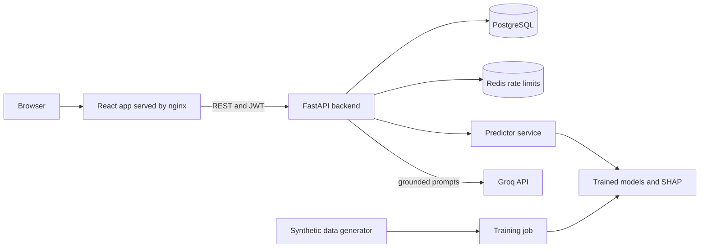
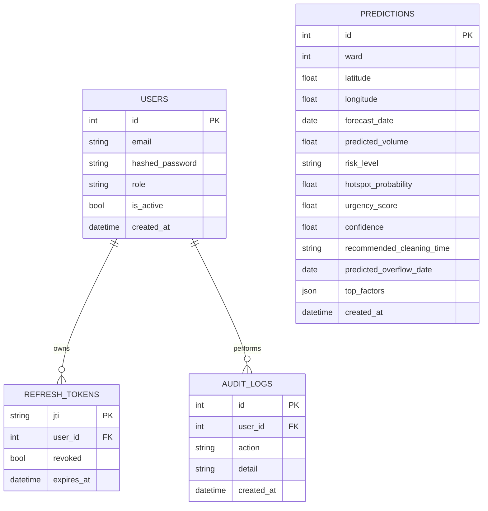
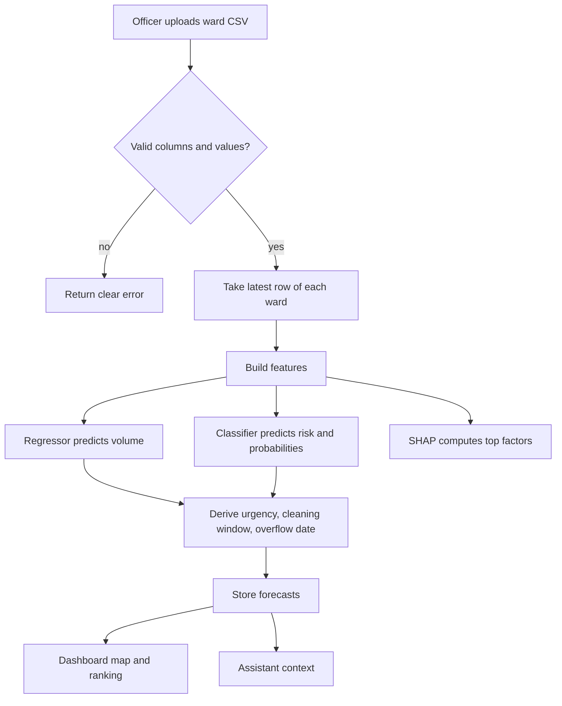
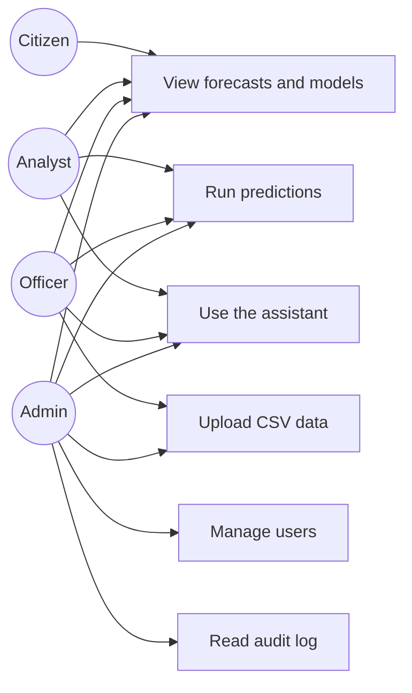
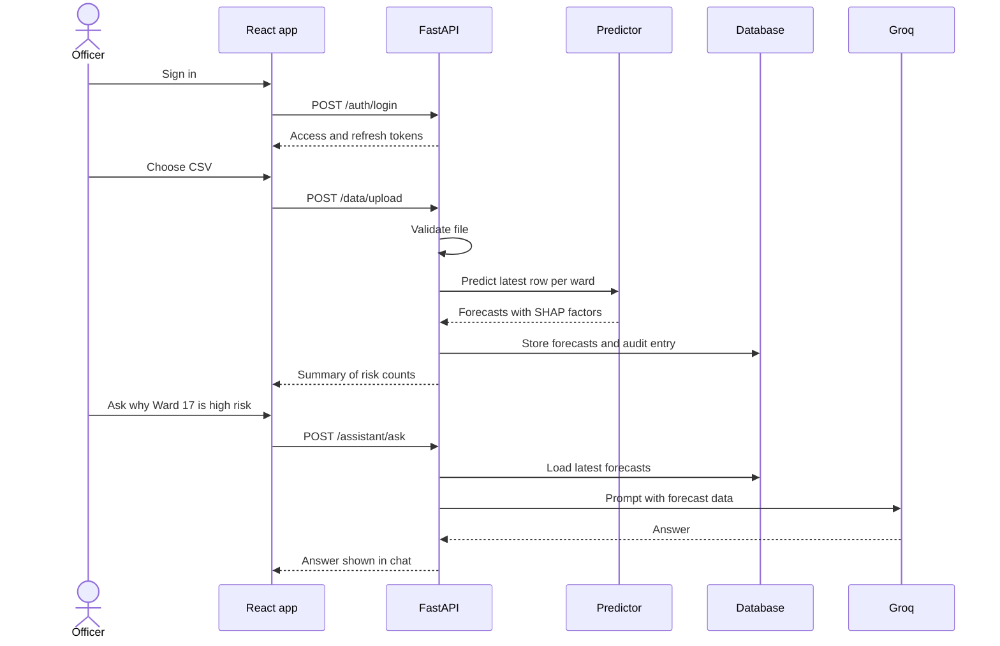

# Architecture and diagrams

All diagrams use Mermaid, which GitHub renders automatically.

## System architecture

## Entity relationship diagram

Predictions are not linked to users. Who created a forecast is recorded in the audit log.

## Workflow

## Use cases

## Sequence: upload, forecast, ask

